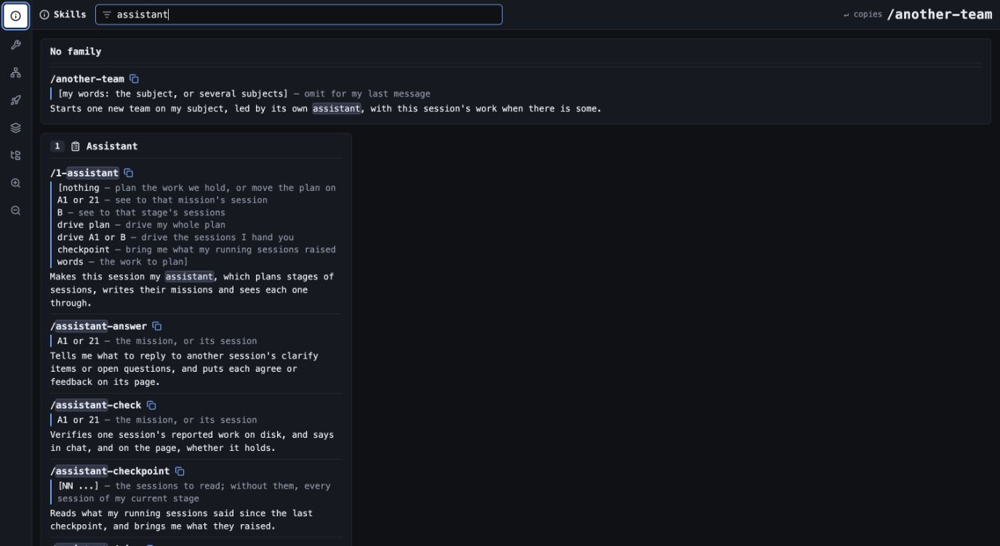

# Claude Behavior Layer

**My working environment for building with Claude Code.**

[Explore the interface](https://ceasar369.github.io/claude-behavior-layer/) · [Try it locally](#try-it-locally)

I built this around how I want to work.
I describe the outcome, examine proposals, and make decisions.
The layer coordinates the sessions doing the work.

It combines communication rules, reusable workflows, and local tools.
A browser dashboard brings decisions and progress together.
Python hooks handle selected session actions without another model turn.



*Current Skills interface, filtered for assistant, with empty sample state.*
*The screenshot contains no live session data.*

## Why it exists

A good conversation should lead to software I actually want.
That needs more than a long opening prompt.

I want sessions to preserve context and explain decisions clearly.
I want parallel work organized into explicit missions.
I want to inspect prototypes before committing to their direction.
I want handovers that preserve the work already done.

This repository contains the working system behind that approach.

## What it does

| Part | What I use it for |
|---|---|
| Communication rules | Short answers, concrete explanations, and clear next decisions |
| Thinking workflows | Explore a subject before choosing what to build |
| Coding workflows | Plan implementation and check its consequences |
| Assistant sessions | Divide work into missions and coordinate their completion |
| Decision pages | Review a session's proposals and send my rulings |
| Prototypes and walkthroughs | Inspect interfaces and examine how they behave |
| Handovers | Continue work in a fresh session with written context |
| Local dashboard | See sessions, decisions, plans, and tools together |

## One working result

**[Blindfold Chess](https://github.com/Ceasar369/blindfold-chess)** is a personal board-visualization trainer.
It organizes practice into six chapters.
Those cover coordinates, movement, notation, memory, updates, and blind play.

I built its behavior around how I wanted to practice.
Its project-specific layer uses this same approach.
The trainer makes the workflow's output concrete and inspectable.

## Follow one decision

A session prepares two decisions for a welcome note.
Its page shows each decision separately.
I agree with one and change the other.
Pressing Send returns my rulings to the session.
The session then writes the note with that direction.

The clarify tools implement this decision flow.
The approach keeps my decisions visible throughout the work.

## Built for my setup

The full environment targets **macOS, iTerm2, and Claude Code**.
Python powers its dashboard and session tools.
Several integrations depend on terminal and browser configuration.

The rules and playbook are easier to adapt independently.
The whole environment needs its own setup and permissions.
It is a personal working system with documented assumptions.

## Repository shape

| Path | Contents |
|---|---|
| `CLAUDE.md` | Project entry point and working conventions |
| `.claude/rules/` | Communication and reasoning rules |
| `.claude/skills/` | Named workflows, grouped into families |
| `.claude/hooks/` | Event-driven session checks and actions |
| `.claude/lib/` and `.claude/tools/` | Python implementation and local pages |
| `knowledge/0010-playbook/` | The working method behind those workflows |

Live conversations, account files, and runtime state are private.
They belong outside a public source snapshot.

## Try it locally

Use a separate trial folder first.
The full environment requires **macOS and iTerm2**.
Install **Python 3.12+**, **Node.js 22+**, **git**, and current **Claude Code**.
A Claude Code account is needed for live conversations.

Check the commands your terminal will use:

```sh
command -v python3 claude node npx git
python3 --version
claude --version
node --version
```

The plugin manifests were validated with Claude Code **2.1.316**.
An older `claude` earlier on PATH needs updating.
Use Anthropic's [installation instructions](https://code.claude.com/docs/en/setup).

Download the public source and prepare its trial configuration:

```sh
git clone https://github.com/Ceasar369/claude-behavior-layer.git
cd claude-behavior-layer
cp .claude/project.example.json .claude/project.json
python3 scripts/check.py
python3 .claude/lib/project.py
```

The sample names the project **Claude Layer Trial**.
Its branch is **main**; its dashboard uses port **21100**.
That keeps the trial separate from another project's port 1100.
Change the sample's name and branch for your own project.

In iTerm2, open **Settings → General → Magic**.
Enable **Python API**, following [iTerm2's documentation](https://iterm2.com/python-api/tutorial/running.html).
The first pane operation installs the `iterm2` Python package.
macOS may request permission for Python to control iTerm2.

Read the [communication rules](.claude/rules/talking.md) and [reasoning rules](.claude/rules/thinking.md).
Review [project settings](.claude/settings.json) before trusting the folder.
They enable hooks and approve the isolated Playwright browser's tools.

From the trial folder, install the included local mod:

```sh
claude plugin marketplace add --scope local ./.claude/mods
claude plugin install --scope local zero-turn@layer-mods
claude
```

Keep this checkout in place while its local marketplace is installed.
Start Claude from the repository root in iTerm2.
Complete Claude's project-trust and MCP prompts yourself.
Playwright may download Chromium on its first browser use.

Inside Claude Code, run these commands separately:

```text
/0-session-start 02
/00-sessions-dashboard restart
```

Open **http://127.0.0.1:21100**.
The dashboard should show your numbered session.
Try `/2-clarify` with one decision you want explained.

The dashboard can control local sessions and inspect their files.
Keep its controller local; the public site is a static preview.

## Checks and limits

```sh
python3 scripts/check.py
```

This parses 101 Python files and five JSON files.
It runs 49 existing tests using isolated temporary fixtures.
The checks passed on macOS with Python 3.12 and 3.14.
The mod and marketplace validate under Claude Code 2.1.316.
Its documented local installation commands also passed an isolated trial.
A fresh folder containing spaces also passed its hook/configuration checks.

These checks do not start real Claude conversations or panes.
Playwright/MCP startup was not exercised in these checks.
Complete first-run iTerm2, macOS, and Claude prompts during setup.
See [release validation](VALIDATION.md) for exact checks and limits.
Optional Dock, phone, and external-provider integrations require separate configuration.
The full environment uses macOS-specific file watchers and terminal tools.

Live conversations, account files, and runtime state stay outside git.
The sample settings are separate from my own working installation.

MIT license. See [LICENSE](LICENSE).
